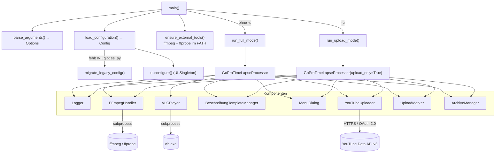

# GoPro Time-Lapse Vibe-Coding Processor – Projektbeschreibung

| Merkmal | Wert |
|---|---|
| **Projektname** | GoPro Time-Lapse Vibe-Coding Processor |
| **Version** | 2.4.1 (`__VERSION__`) |
| **Versionsdatum** | 2026-10-12 (`__DATUM__`; Modul-Docstring nennt abweichend 2026-09-26) |
| **Komplexitätsstufe** | **Large** |
| **Entwicklungsstand** | **Beta** |
| **Dokumentationsstand** | 2026-10-12 |
| **Zugehörige Konfiguration** | `gopro_config.ini` (neutralisierte Fassung „passend zu Skript-Version 2.4.1“) |

**Begründung der Komplexitätsstufe „Large“:** Ein einzelnes Python-Modul mit deutlich über 2.000 Zeilen (Dokumentansicht: 3.255 Zeilen inkl. Kommentare und Docstrings), 13 Klassen, rund 145 Funktionen/Methoden, zwei getrennte Betriebsmodi, externe Prozesse (FFmpeg, ffprobe, VLC), externe API (YouTube Data API v3 mit OAuth 2.0), persistente JSON-Zustandsdateien sowie ein Hintergrund-Thread (`threading.Thread` zum Mitlesen von FFmpeg-`stderr`).

---

## 1. Projektübersicht

### 1.1 Ziel und Kernfunktionalität

Das Skript verarbeitet Zeitrafferaufnahmen einer **GoPro Hero 5 Black** von der Rohdatei bis zum veröffentlichten YouTube-Video. Es führt den Nutzer über ein interaktives Konsolenmenü durch:

1. Auswahl eines Aufnahmeordners (ein Unterordner je Aufnahme)
2. Ermittlung von Materiallänge und realer Aufnahmedauer (Wanduhrzeit)
3. Vorschau des Rohmaterials in VLC
4. Iteratives Testen eines Geschwindigkeitsfaktors per Testrender
5. Eingabe oder Vorlage für Titel, Beschreibung, Tags, Sichtbarkeit
6. Finalrender aller Chapter in **einem** FFmpeg-Durchgang (concat-Filter + `setpts`)
7. YouTube-Upload mit Fortschritt, Retry und Playlist-Zuordnung
8. Uploadmarker schreiben und das Video archivieren

Zusätzlich gibt es einen **Stapel-Uploadmodus** (`-u`), der bereits gerenderte Videos aus Archiv- und Ausgabeordner ohne Neu-Rendern hochlädt, optional als Trockenlauf (`--dry-run`).

### 1.2 Zielgruppe / Nutzerprofil

- Primär: Ein einzelner technisch versierter Anwender, der regelmäßig GoPro-Zeitraffer auf einem eigenen YouTube-Kanal veröffentlicht (Windows-Arbeitsplatz).
- Sekundär: Power-User, die die INI-Konfiguration anpassen, Encoder wählen oder das Skript weiterentwickeln.

### 1.3 Einzigartige Verkaufsargumente (USPs)

| USP | Umsetzung im Code |
|---|---|
| Kein stiller Materialverlust beim Zusammenfügen | Ein-Pass-Render über concat-**Filter** statt Stream-Copy-Concat (`FFmpegHandler.render_from_files`), anschließend Vollständigkeitsprüfung der Ausgabe gegen „Summe Quelldauern / Faktor“ (`render_final`) |
| Korrekte Chapter-Reihenfolge der Hero 5 | Beide Namensschemata (`GOPR1290` = Chapter 0, `GP011290` = Chapter 1 …) über `parse_gopro_name` / `sort_gopro_files` |
| Abstrakte Encoder-Konfiguration | Nutzer wählt nur `qualitaet`/`tempo`; `ENCODER_PROFILES` übersetzt in encoderspezifische FFmpeg-Parameter; automatischer Hardware-Encoder-Test mit Fallback `libx264` |
| Fehler vor dem Render statt nach Stunden | `Config.validate` und `validate_youtube_metadata` prüfen YouTube-Limits **vor** dem Render |
| Wiederaufnehmbare Uploads | `.uploaded.json`-Marker mit Upload-Historie; offene Uploads werden beim nächsten Start angeboten |
| Schnelle Ordnerliste | Persistenter Medienindex `.gopro-media-index.json` je Aufnahmeordner; nur neue/geänderte MP4 werden erneut mit ffprobe geprüft |
| Reale Aufnahmedauer in der Beschreibung | `estimate_span` rechnet die Wanduhrzeit inkl. erstem Chapter hoch (Plausibilitätsgrenzen `SPAN_RATIO_MIN`/`SPAN_RATIO_MAX`) |
| Kommentar-erhaltendes Zurückschreiben der INI | `Config.save_ziel_fps` ersetzt gezielt eine Zeile, mit `.bak`-Sicherung und atomarem `os.replace` |

### 1.4 Entwicklungsstand: **Beta**

| Indiz | Bewertung |
|---|---|
| Produktiver Einsatz belegt (Changelog nennt reale Ordner, z. B. `2026-09-25`, und Produktivwerte 12h 26min / 14min 56s) | spricht für Beta+ |
| Umfangreiche, gezielte Fehlerbehandlung, atomare Schreibvorgänge, Plausibilitätsprüfungen | spricht für Beta+ |
| Keine automatisierten Tests, keine gepinnten Abhängigkeiten, keine Paketierung | gegen Production-Ready |
| Windows-zentriert (VLC-Pfade, `NUL`, `STARTUPINFO`, Konsolen-Encoding), plattformabhängiges Verhalten bei `*.MP4`-Globbing | gegen Production-Ready |
| Bekannte offene Schwachstellen (siehe 3.4), u. a. Render direkt auf den Endnamen | gegen Production-Ready |

---

## 2. Funktionale Anforderungen

### 2.1 Feature-Liste

| # | Feature | Priorität | Status | Umsetzung |
|---|---|---|---|---|
| F01 | Aufnahmeordner auflisten (Start, Zeitraum, Material, Dateianzahl) | 🔴 Must | ✅ | `list_recordings`, `MenuDialog.show_recording_list` |
| F02 | Chapter-Sortierung nach GoPro-Namensschema, Fallback Zeitstempel | 🔴 Must | ✅ | `parse_gopro_name`, `sort_gopro_files` |
| F03 | Testrender mit frei wählbarem Faktor und VLC-Vorschau (Schleife) | 🔴 Must | ✅ | `render_preview`, `adjust_speed_with_progress`, `get_speed_factor` |
| F04 | Ein-Pass-Finalrender aller Chapter ohne Tonspur | 🔴 Must | ✅ | `render_final`, `render_from_files` |
| F05 | Vollständigkeitsprüfung der Ausgabe (Toleranz max(1 s, 2 %)) | 🔴 Must | ✅ | `render_final` |
| F06 | YouTube-Upload (resumable, 8-MB-Chunks, 5 Retries, Fortschritt) | 🔴 Must | ✅ | `YouTubeUploader.upload_video` |
| F07 | OAuth-Anmeldung mit Token-Speicherung und Refresh | 🔴 Must | ⚠️ | `_get_credentials` – Refresh-Fehler wird nicht abgefangen (kein automatischer Neu-Login) |
| F08 | INI-Konfiguration mit Typprüfung und harten/weichen Fehlern | 🔴 Must | ✅ | `Config`, `load_configuration`, `Config.validate` |
| F09 | Vorabprüfung YouTube-Limits (Titel 100, Beschreibung 5000, Tags 500 Zeichen, `<`/`>`) | 🔴 Must | ✅ | `validate_youtube_metadata` |
| F10 | Uploadmarker mit Historie, Migration alter Marker | 🟡 Should | ✅ | `UploadMarker` |
| F11 | Archivierung mit Retry bei Dateisperre und Konfliktnamen | 🟡 Should | ⚠️ | `ArchiveManager.archive_with_retry` – Duplikatfall lässt Marker verwaist zurück |
| F12 | Offene Uploads beim Start nachholen | 🟡 Should | ✅ | `find_pending_uploads`, `show_pending_uploads`, `resume_pending_uploads` |
| F13 | Stapel-Uploadmodus `-u` (Archiv + Ausgabe, Auswahl-Syntax `a`, `1,3`, `2-5`, `1,4-6`) | 🟡 Should | ✅ | `run_upload_mode`, `parse_selection` |
| F14 | Trockenlauf `--dry-run` | 🟡 Should | ⚠️ | Kein Upload/Verschieben, aber Logdatei, Verzeichnisse und Medienindex werden trotzdem geschrieben |
| F15 | Beschreibungs-Vorlagen (`*-beschreibung.md`, `*_beschreibung.md`) | 🟡 Should | ✅ | `BeschreibungTemplateManager` |
| F16 | Automatische Encoder-Erkennung (NVENC → QSV → AMF → VideoToolbox → libx264) | 🟡 Should | ✅ | `_auto_detect_encoder`, `_probe_encoder_works` |
| F17 | Wanduhrzeit-Hochrechnung inkl. erstem Chapter | 🟡 Should | ✅ | `estimate_span` |
| F18 | Persistenter Medienindex | 🟡 Should | ✅ | `_get_media_data`, `_read_media_index`, `_write_media_index` |
| F19 | Ziel-FPS als Vorbelegung zurückschreiben | 🟢 Could | ✅ | `Config.save_ziel_fps`, `get_target_fps` |
| F20 | Migration `gopro_config.py` → `gopro_config.ini` | 🟢 Could | ✅ | `migrate_legacy_config` |
| F21 | Konsolen-Darstellung konfigurierbar (Farben, Symbole, Breite, ausführlich) | 🟢 Could | ✅ | `UI`, Abschnitt `[Anzeige]` |
| F22 | Automatisches Aufräumen des Temp-Ordners schaltbar | 🟢 Could | ❌ | `temp_auto_cleanup` wird eingelesen, aber nirgends ausgewertet; Aufräumen erfolgt immer |
| F23 | Speicherung von Faktor/FPS je Video (für spätere Beschreibung) | 🟢 Could | ❌ | Laut Docstring bewusst nicht vorhanden („der Faktor wird nirgends gespeichert“) |

### 2.2 Use Cases

**UC-01 – Aufnahme rendern und veröffentlichen (Vollmodus)**
Als *Zeitraffer-Fotograf* möchte ich *eine Aufnahme auswählen, den Faktor per Vorschau festlegen und das Video in einem Durchgang rendern und hochladen*, um *ohne manuelle Zwischenschritte ein vollständiges Video auf YouTube zu haben*.

| Szenario | Ablauf / Ergebnis |
|---|---|
| Erfolg | Schritte 1–8 durchlaufen → `<Ordner>_final.mp4` im `output_dir` → Upload → Marker → Verschiebung ins `archiv_dir` → `show_final_summary` mit `https://youtu.be/<ID>`; Ziel-FPS wird bei Änderung in die INI geschrieben |
| Fehler: Metadaten zu lang | Abbruch in Schritt 6 **vor** dem Render („Die Metadaten verletzen YouTube-Limits:“) |
| Fehler: Ausgabe zu kurz | Warnung „Das Ergebnis ist kuerzer als erwartet!“, Stream-Übersicht; Upload läuft **trotzdem**; Warnung wird in der Abschlussübersicht wiederholt |
| Fehler: Upload scheitert | Video bleibt im `output_dir`; wird beim nächsten Start als offener Upload angeboten oder per `-u` nachholbar |
| Fehler: Archiv gesperrt | `archiv_versuche` × `archiv_wartezeit` Sekunden Retry, danach Hinweis; Upload gilt als erfolgreich |

**UC-02 – Fertige Videos im Stapel hochladen (`-u`)**
Als *Kanalbetreiber* möchte ich *mehrere bereits gerenderte Videos mit einer gemeinsamen Vorlage und Sichtbarkeit hochladen*, um *Nacharbeiten ohne Neu-Rendern und ohne Eingaben je Datei zu erledigen*.

| Szenario | Ablauf / Ergebnis |
|---|---|
| Erfolg | Kandidaten aus Archiv (`A`) und Ausgabe (`O`) → Auswahl → Vorlage (Pflicht) → Sichtbarkeit → Zusammenfassung → Upload je Datei → Bilanz (Erfolgreich / Übersprungen / Fehlgeschlagen) |
| Re-Upload | Bereits hochgeladene Videos werden mit YouTube-Link angezeigt; einmalige Rückfrage; bei „n“ nur nicht hochgeladene |
| Keine Vorlage | Abbruch „Keine Beschreibungs-Vorlage gefunden.“ |
| Einzelfehler | Datei wird übersprungen bzw. als Fehler gezählt, Stapel läuft weiter |

**UC-03 – Trockenlauf**
Als *Nutzer* möchte ich *mit `-u --dry-run` sehen, welche Titel und Beschreibungen entstehen würden*, um *einen großen Stapel gefahrlos zu prüfen*.
Erfolg: Kein Upload, kein Verschieben, keine Marker. Einschränkung: Logdatei, Verzeichnisse und ggf. `.gopro-media-index.json` werden geschrieben.

**UC-04 – Offene Uploads nachholen**
Als *Nutzer* möchte ich *beim Start erkennen, welche gerenderten Videos noch nicht hochgeladen wurden*, um *nach einem Abbruch nicht neu rendern zu müssen*.
Erfolg: Auswahl `a`/`1,3`/`2-5`/`n`; je Video Titel/Beschreibung/Tags abfragen, prüfen, hochladen, archivieren. Fehler: Datei verschwunden → Warnung im Log, weiter.

**UC-05 – Konfiguration aus Altversion übernehmen**
Als *Bestandsnutzer* möchte ich, dass *eine vorhandene `gopro_config.py` automatisch in `gopro_config.ini` überführt wird*, um *keine Einstellungen zu verlieren*.
Fehler: Python-Datei fehlerhaft → Meldung, Programmende mit Code 1; die alte Datei bleibt unverändert.

---

## 3. Nicht-funktionale Anforderungen

### 3.1 Leistungsziele (aus dem Code abgeleitet)

| Aspekt | Umsetzung / Kennwert |
|---|---|
| Schreiblast Finalrender | Keine Zwischendatei mehr; laut Changelog entfallen 6–9 GB Schreiblast je Lauf |
| Renderzeit | Hardware-Encoder bevorzugt; `-threads 0`; Encoder-Test einmalig beim Start (Timeout 30 s je Kandidat); im Uploadmodus übersprungen |
| Ordnerliste | Medienindex: ffprobe nur für neue/geänderte Dateien (Validierung über Name, `size`, `mtime_ns`) |
| Upload | Resumable, Chunkgröße 8 MiB, max. 5 Wiederholungen mit 2/4/8/16/32 s Wartezeit |
| Testrender | Quelle = größte `.LRV`-Datei (niedrig aufgelöst), sonst größte MP4; Ergebnis im Prozess gecacht (`_preview_cache`) |
| Speicher | Keine Größenlimits im Code; alle Chapter werden im Finalrender gleichzeitig als FFmpeg-Eingänge geöffnet |
| Max. Dateigröße | Im Code nicht begrenzt; YouTube-Limits für Dateigröße werden nicht geprüft |

### 3.2 Sicherheitsaspekte

| Aspekt | Bewertung |
|---|---|
| Eingabevalidierung | Konsoleneingaben werden in Schleifen validiert (Bereiche, Zahlen, j/n); INI-Werte typisiert mit Min/Max; Selektion verwirft die gesamte Eingabe bei unbekannten Bestandteilen |
| Prozessaufrufe | `subprocess` stets mit Argumentliste, kein `shell=True` → keine Shell-Injection über Dateinamen |
| OAuth-Token | `token_file` wird im Klartext-JSON gespeichert; Scope `https://www.googleapis.com/auth/youtube` (Vollzugriff, nötig für `playlistItems().insert`) |
| Client-Secret | Pfad aus der INI; Datei liegt außerhalb des Skripts (neutralisierte INI enthält Platzhalter) |
| Legacy-Migration | `migrate_legacy_config` führt `gopro_config.py` per `exec_module` aus – beliebiger Python-Code in dieser Datei würde ausgeführt |
| Dateischreibvorgänge | Marker, Medienindex und INI über temporäre Datei + `os.replace` (atomar); INI zusätzlich mit `.bak` |
| Metadaten | `<` und `>` in Titel/Beschreibung werden vor dem Upload abgewiesen |

### 3.3 Skalierbarkeit und Erweiterbarkeit

- **Encoder:** neuer Encoder = neuer Eintrag in `ENCODER_PROFILES` (Label, `speed_flag`, `speed`, `quality`).
- **Vorlagen-Abschnitte:** neue Überschrift = Eintrag in `BeschreibungTemplateManager.HEADER_MAP` plus Auswertung in `parse`.
- **Konfiguration:** neue Werte über `Config.text/flag/number/items` in `_load_values`.
- **Grenzen:** Ein Modul, eine zentrale Orchestrierungsklasse (`GoProTimeLapseProcessor`) und lange Ablauffunktionen (`run_full_mode`, `run_upload_mode`) erschweren isoliertes Testen. Sequenzielle Verarbeitung, kein paralleler Upload.

### 3.4 Identifizierte Schwachstellen

| # | Schweregrad | Schwachstelle | Fundstelle |
|---|---|---|---|
| S01 | 🔴 Kritisch | FFmpeg schreibt direkt auf den Endnamen `<Ordner>_final.mp4`. Bricht der Render ab (Strg+C, FFmpeg-Fehler), bleibt eine unvollständige Datei ohne Marker liegen und wird beim nächsten Start als **offener Upload** angeboten bzw. im Uploadmodus als `O` gelistet – ohne erneute Vollständigkeitsprüfung. | `render_from_files`, `find_pending_uploads`, `collect_upload_candidates` |
| S02 | 🔴 Kritisch | Eine als unvollständig erkannte Ausgabe (`is_complete = False`) wird bewusst trotzdem automatisch hochgeladen; es gibt keine Rückfrage. | `run_full_mode`, `render_final` |
| S03 | 🟡 Mittel | Existiert `<Ordner>_final.mp4` bereits **mit** Marker, wird ohne Rückfrage überschrieben (nur Info). Scheitert der neue Render, steht neben einer kaputten Datei ein gültiger Marker. | `run_full_mode` (Kollisionsprüfung) |
| S04 | 🟡 Mittel | `--dry-run` ist nicht nebenwirkungsfrei: Logdatei, Verzeichnisse (`mkdir`) und über `get_source_span_for_video` → `_get_media_data` ggf. `.gopro-media-index.json` werden geschrieben. Die Hilfe verspricht „nichts … geschrieben“. | `run_upload_mode`, `GoProTimeLapseProcessor.__init__` |
| S05 | 🟡 Mittel | Archiv-Duplikat (gleiche Größe): Quelle wird gelöscht, der Marker mit der **neuen** YouTube-ID bleibt verwaist im Ausgabeordner; der Archiv-Marker kennt die neue ID nicht. | `ArchiveManager.archive_with_retry` |
| S06 | 🟡 Mittel | `credentials.refresh(Request())` ist nicht abgesichert. Ein widerrufenes/abgelaufenes Refresh-Token führt zum Upload-Fehler statt zum Browser-Login; `token_file` muss manuell gelöscht werden. | `YouTubeUploader._get_credentials` |
| S07 | 🟡 Mittel | Plattformabhängigkeit: `render_final` nutzt `get_file_list(..., "*.MP4")`, die Dauerermittlung `_sorted_mp4` dagegen `*.MP4` **und** `*.mp4`. Auf Linux/macOS (case-sensitiv) fehlen kleingeschriebene Dateien im Render → Fehlalarm „kuerzer als erwartet“ bzw. Abbruch „Keine Dateien“. | `render_final`, `get_file_list`, `_sorted_mp4` |
| S08 | 🟡 Mittel | Annahme: Bei sehr vielen Chaptern kann die FFmpeg-Kommandozeile (je Datei Pfad + ca. 110 Zeichen Filterkette) das Windows-Limit von 32.767 Zeichen überschreiten; zudem werden alle Eingänge gleichzeitig geöffnet. | `render_from_files` |
| S09 | 🟢 Gering | `temp_auto_cleanup` wird eingelesen, aber nicht ausgewertet. | `Config._load_values` |
| S10 | 🟢 Gering | Toter bzw. ungenutzter Code: `get_total_source_duration_for_video`, Parameter `limit_files`, `_material_cache` (nur geschrieben), `Logger.errors` (nie ausgegeben), `complete`/`cache_hits` im Medienergebnis. | diverse |
| S11 | 🟢 Gering | `materiallaenge_in_liste = false` spart keine ffprobe-Aufrufe, da `estimate_span` die Dauern ohnehin benötigt; nur die Anzeige entfällt. | `list_recordings` |
| S12 | 🟢 Gering | Upload-Retry fängt **alle** Exceptions (auch nicht-transiente wie Quota/400) → bis zu 62 s Wartezeit ohne Erfolgsaussicht. | `upload_video` |
| S13 | 🟢 Gering | `parse_selection` verwirft Nummern außerhalb des Bereichs stillschweigend (`0,1` → nur 1; `1-99` wird gekappt). | `parse_selection` |
| S14 | 🟢 Gering | `format_span` zeigt für Zeitspannen von 1–59 s „0h 0min“. | `format_span` / `format_h_min` |
| S15 | 🟢 Gering | `save_ziel_fps` entfernt einen Inline-Kommentar hinter `ziel_fps = …`. | `Config.save_ziel_fps` |
| S16 | 🟢 Gering | Logdateien werden je Lauf neu angelegt, nie rotiert oder gelöscht. | `Logger` |
| S17 | 🟢 Gering | Inkonsistente Versionsangaben: Docstring „Datum: 2026-09-26“ vs. `__DATUM__ = "2026-10-12"`; Kommentar „8. Rendern, hochladen, archivieren“ vs. `ui.step(7, …)`/`ui.step(8, …)`; die Bestätigung hat keinen eigenen Schritt. | Modulkopf, `run_full_mode` |
| S18 | 🟢 Gering | Tag-Längenprüfung zählt Zeichen + Kommas; Annahme: YouTube rechnet Tags mit Leerzeichen inkl. Anführungszeichen – Grenzfälle könnten erst beim Upload scheitern. | `validate_youtube_metadata` |
| S19 | 🟢 Gering | `list_recordings` ruft `stat()` ohne Fehlerbehandlung auf; eine während des Scans gelöschte Datei führt zum Absturz. | `list_recordings` |

---

## 4. Technische Spezifikation

### 4.1 Systemarchitektur



### 4.2 Datenfluss

```mermaid
flowchart LR
    A["Aufnahmeordner<br/>GOPRxxxx.MP4, GPnnxxxx.MP4, *.LRV"] --> B["_get_media_data<br/>ffprobe-Dauern + .gopro-media-index.json"]
    B --> C["estimate_span<br/>Wanduhrzeit (float s), Verhältnis"]
    A --> D["render_preview<br/>temp/preview_{n}s.mp4"]
    D --> E["VLC-Vorschau → Faktor bestätigt"]
    E --> F["get_job_details<br/>Titel, Beschreibung, Tags, Sichtbarkeit"]
    F --> G["validate_youtube_metadata"]
    G --> H["render_from_files<br/>output/<Ordner>_final.mp4 (H.264, yuv420p, ohne Ton)"]
    H --> I["render_final: Ist-Dauer vs. Summe/Faktor"]
    I --> J["YouTubeUploader.upload_video → Video-ID"]
    J --> K["UploadMarker.write_marker<br/>*.mp4.uploaded.json"]
    K --> L["ArchiveManager → archiv/"]
    L --> M["Config.save_ziel_fps → gopro_config.ini (+ .bak)"]
```



| Stufe | Eingabe (Typ/Format) | Ausgabe (Typ/Format) |
|---|---|---|
| Konfiguration | `gopro_config.ini` (UTF-8, INI, `;`/`#`-Kommentare, keine Interpolation) | `Config`-Objekt (typisierte Attribute) |
| Ordnerscan | Unterordner von `aufnahmen_dir` mit `*.MP4`/`*.mp4` | `List[Dict[str, Any]]` (Aufnahmen) |
| Dauerermittlung | MP4-Pfade (`str`) | `float` Sekunden (ffprobe `format=duration`), JSON-Index |
| Testrender | größte LRV/MP4, Faktor `float`, FPS `int`, Dauer `int` | `temp/preview_{preview_duration}s.mp4` (wird nach Wiedergabe gelöscht) |
| Finalrender | `List[Path]`, Faktor, FPS, erwartete Dauer | `output/<Ordner>_final.mp4`, Renderzeit `float` |
| Upload | MP4, Titel/Beschreibung (`str`), Tags (`List[str]`), Datum `YYYY-MM-DD` | YouTube-Video-ID (`str`), Uploadzeit `float` |
| Abschluss | Video-ID, Titel, Sichtbarkeit | `<video>.mp4.uploaded.json`, Datei im `archiv_dir` |

### 4.3 Datenmodell

| Struktur | Typ | Inhalt |
|---|---|---|
| `Options` | Klasse | `upload_mode: bool`, `dry_run: bool` |
| `Config` | Klasse | Alle INI-Werte als Attribute (`yt_*`, `*_dir`, `encoder`, `qualitaet`, `tempo`, `ziel_fps`, …) |
| `ENCODER_PROFILES` | `Dict[str, Dict[str, Any]]` | je Encoder: `label`, `speed_flag`, `speed` (Stufe → Wert), `quality` (Stufe → Argumentliste) |
| `QUALITY_LEVELS` / `SPEED_LEVELS` | `tuple` | `niedrig…maximal` / `sehr_schnell…langsam` |
| Aufnahme-Eintrag (`list_recordings`) | `dict` | `name`, `start`, `span_seconds`, `span_str`, `span_ratio`, `material_seconds`, `material_str`, `file_count` |
| Medienergebnis (`_get_media_data`) | `dict` | `files`, `durations`, `total`, `failures`, `complete`, `cache_hits`, `probed` |
| Medienindex `.gopro-media-index.json` | JSON | `schema_version` (=1), `generated_at`, `files{Name: {size, mtime_ns, duration_seconds}}`, `summary{file_count, material_seconds, probe_failures, complete}` |
| Uploadmarker `*.uploaded.json` | JSON | `youtube_video_id` (jüngster), `source`, `video_filename`, `title`, `privacy_status`, `playlist_id`, `uploaded_at_utc`, `upload_count`, `uploads[]` |
| Upload-Kandidat (`collect_upload_candidates`) | `dict` | `path`, `origin`, `origin_short` (`A`/`O`), `in_archive`, `size_mb`, `mtime`, `mtime_raw`, `marker` |
| Stapel-Eintrag (`prepare_batch_entries`) | `dict` | Kandidat + `recording_date`, `period_str`, `title`, `description`, `tags`, `privacy` |
| Stapel-Bilanz (`run_batch_upload`) | `Dict[str, List[str]]` | `erfolg`, `uebersprungen`, `fehler` |
| Vorlagen-Ergebnis (`BeschreibungTemplateManager.parse`) | `Dict[str, str]` | `title`, `description`, `tags`, `recording_date`, `privacy_status` |
| Caches in `GoProTimeLapseProcessor` | `dict` | `_preview_cache`, `_material_cache`, `_span_cache`, `_media_data_cache`, `_media_index_stats` |
| Cache in `FFmpegHandler` | `Dict[str, float]` | `_duration_cache` |
| `Logger.warnings` / `Logger.errors` | `List[str]` | gesammelte Meldungen des Laufs |

### 4.4 Externe Abhängigkeiten

Im Code sind keine Paketversionen festgelegt; „ungepinnt“ kennzeichnet dies.

```
# --- Python-Pakete (pip) ---
google-api-python-client==<ungepinnt>   # googleapiclient.discovery.build, googleapiclient.http.MediaFileUpload
google-auth==<ungepinnt>                # google.oauth2.credentials.Credentials, google.auth.transport.requests.Request
google-auth-oauthlib==<ungepinnt>       # google_auth_oauthlib.flow.InstalledAppFlow (Browser-Login)
google-auth-httplib2==<ungepinnt>       # wird in der Installationsmeldung des Skripts empfohlen, nicht direkt importiert
requests==<ungepinnt>                   # Laufzeitvoraussetzung von google.auth.transport.requests (transitiv)

# --- Externe Programme ---
ffmpeg                                  # Encoder-Test, Testrender, Finalrender (Pflicht, PATH)
ffprobe                                 # Dauer, Auflösung, creation_time, Stream-Übersicht (Pflicht, PATH)
VLC media player                        # Vorschau (optional; ohne VLC werden Vorschauen übersprungen)

# --- Standardbibliothek ---
sys, io, os, re, json, time, shutil, threading, subprocess, configparser,
datetime, pathlib, typing, importlib.util (Migration), ctypes (ANSI unter Windows)
```

### 4.5 Konfigurationsparameter (`gopro_config.ini`)

„Code-Default“ gilt, wenn der Eintrag fehlt oder leer ist. „Neutral-INI“ ist der Wert der mitgelieferten neutralisierten Datei.

| Abschnitt | Schlüssel → Attribut | Typ | Code-Default | Neutral-INI | Gültigkeit / Beschreibung |
|---|---|---|---|---|---|
| `[YouTube]` | `client_secrets_file` → `yt_client_secrets` | Pfad | **Pflicht** | `C:\PATH\TO\client_secret.json` | OAuth-Client-Datei; fehlt der Eintrag → ConfigError |
| | `token_file` → `yt_token_file` | Pfad | **Pflicht** | `C:\PATH\TO\token.json` | Speicherort des OAuth-Tokens |
| | `playlist_id` → `yt_playlist_id` | str | `""` | leer | leer = keine Playlist-Zuordnung (Log-Warnung) |
| | `privacy_status` → `yt_privacy` | str | `private` | `private` | `public` \| `private` \| `unlisted`; sonst harter Fehler |
| | `tags` → `yt_tags` | Liste (Komma) | `Zeitraffer, GoPro` | `Zeitraffer, GoPro, Time-Lapse, 4K` | Standard-Tags; leer → Warnung |
| | `category_id` → `yt_category_id` | str (Ziffern) | `19` | `19` | nur Ziffern; sonst harter Fehler |
| | `public_stats_viewable` → `yt_public_stats` | bool | `true` | `true` | Statistiken öffentlich |
| | `embeddable` → `yt_embeddable` | bool | `true` | `true` | Einbetten erlaubt |
| | `license` → `yt_license` | str | `youtube` | `creativeCommon` | `youtube` \| `creativeCommon` (Groß-/Kleinschreibung relevant); sonst harter Fehler |
| | `made_for_kids` → `yt_made_for_kids` | bool | `false` | `false` | `selfDeclaredMadeForKids` |
| | `contains_synthetic_media` → `yt_synthetic` | bool | `false` | `false` | `containsSyntheticMedia` |
| `[Verzeichnisse]` | `basis_dir` → `base_dir` | Pfad | Skriptordner | `C:\DATA\GoPro` | Basis für leere Unterordner |
| | `aufnahmen_dir` | Pfad | `<basis>/aufnahmen` | leer | ein Unterordner je Aufnahme |
| | `output_dir` | Pfad | `<basis>/output` | leer | gerenderte Videos |
| | `archiv_dir` | Pfad | `<basis>/archiv` | leer | hochgeladene Videos |
| | `log_dir` | Pfad | `<basis>/logs` | leer | Logdateien |
| | `temp_dir` | Pfad | `<basis>/temp` | leer | Vorschaudateien |
| | `beschreibung_dir` | Pfad | `<basis>/beschreibungen` | leer | Vorlagen (rekursiv durchsucht) |
| `[Render]` | `encoder` | str | `auto` | `auto` | `auto` \| `libx264` \| `h264_nvenc` \| `h264_qsv` \| `h264_amf` \| `h264_videotoolbox`; Unbekannte werden getestet, Fallback `libx264` |
| | `qualitaet` | str | `hoch` | `hoch` | `niedrig` \| `mittel` \| `hoch` \| `maximal`; unbekannt → Warnung, `hoch` |
| | `tempo` | str | `schnell` | `schnell` | `sehr schnell` \| `schnell` \| `ausgewogen` \| `langsam` (normalisiert über `normalize_key`); unbekannt → `schnell` |
| | `ziel_fps` | int | `0` | `120` | 0–240; 0 = keine Vorbelegung; wird vom Skript aktualisiert |
| | `ziel_fps_merken` | bool | `true` | `true` | Ziel-FPS nach erfolgreichem Lauf zurückschreiben |
| `[Ablauf]` | `testrender_dauer` | int (s) | `20` | `5` | 1–300; Vorbelegung der Testrender-Dauer |
| | `erste_vorschau_dauer` | int (s) | `20` | `5` | 1–600; Länge der Rohmaterial-Vorschau |
| | `temp_auto_cleanup` | bool | `true` | `true` | wird eingelesen, aber **nicht ausgewertet** |
| | `archiv_versuche` | int | `6` | `6` | 1–100; Versuche bei Dateisperre |
| | `archiv_wartezeit` | int (s) | `10` | `10` | 0–600; Pause zwischen Versuchen |
| | `materiallaenge_in_liste` | bool | `true` | `true` | Materialspalte in der Aufnahmeliste |
| `[Anzeige]` | `farben` → `anzeige_farben` | bool | `true` | `true` | ANSI-Farben (nur bei TTY, nicht bei `NO_COLOR`) |
| | `symbole` → `anzeige_symbole` | bool | `true` | `true` | Emoji statt ASCII-Ersatz (`[OK]`, `[!]` …) |
| | `ausfuehrlich` → `anzeige_ausfuehrlich` | bool | `false` | `false` | jede Logzeile auch auf der Konsole |
| | `breite` → `anzeige_breite` | int | `78` | `78` | 40–200 Zeichen |

Boolesche Werte: `true/yes/ja/an/on/1` bzw. `false/no/nein/aus/off/0`.

**Kommandozeile:** `-u`/`--upload`, `--dry-run`/`--dryrun`/`-n`, `-h`/`--help`/`/?`/`-?`, `--version`/`-v` (Groß-/Kleinschreibung egal).

**Feste Konstanten:** `YT_MAX_TITLE_LEN = 100`, `YT_MAX_DESCRIPTION_LEN = 5000`, `YT_MAX_TAGS_TOTAL_LEN = 500`, `SPAN_RATIO_MIN = 1.0`, `SPAN_RATIO_MAX = 500.0`, `MEDIA_INDEX_FILENAME = ".gopro-media-index.json"`, `MEDIA_INDEX_SCHEMA_VERSION = 1`, `TOTAL_STEPS = 8`.

---

## 5. Qualitätssicherung

### 5.1 Teststrategie

| Ebene | Umfang | Werkzeug (Empfehlung) |
|---|---|---|
| Unit | Reine Funktionen: `format_*`, `normalize_key`, `parse_selection`, `parse_gopro_name`, `sort_gopro_files`, `validate_youtube_metadata`, `build_description`, `Config.flag/number`, `BeschreibungTemplateManager.parse`, `UploadMarker` | `pytest` mit `tmp_path` |
| Integration | `FFmpegHandler` mit synthetischem Material (`ffmpeg -f lavfi testsrc`), `_get_media_data`, `estimate_span` (gesetzte `mtime` via `os.utime`), `ArchiveManager`, `Config.save_ziel_fps` | `pytest` + echte ffmpeg-Binärdatei |
| E2E | Vollmodus mit Mini-Aufnahme und gemocktem `YouTubeUploader`; `-u --dry-run` | `pytest` + `monkeypatch` für `input`/`ask` |

### 5.2 Testfälle für kritische Pfade

**`parse_gopro_name` / `sort_gopro_files`**
```
Test: Erstes Chapter im GOPR-Schema
Input: "GOPR1290"
Erwartetes Ergebnis: (1290, 0)
Fehlerfall: "GOPR12" → None

Test: Folgechapter
Input: "GP021290"
Erwartetes Ergebnis: (1290, 2)
Fehlerfall: "DJI_0001" → None

Test: Sortierung gemischter Schemata
Input: [GP021290.MP4, GOPR1290.MP4, GP011290.MP4]
Erwartetes Ergebnis: [GOPR1290.MP4, GP011290.MP4, GP021290.MP4], True
Fehlerfall: eine Datei "clip.MP4" in der Liste → Sortierung nach mtime, Rückgabe False + Warnung
```

**`parse_selection`**
```
Test: Kombination
Input: raw="1,4-6", count=6
Erwartetes Ergebnis: [0, 3, 4, 5]
Fehlerfall: "1,x" → None (gesamte Eingabe ungültig)

Test: Umgekehrter Bereich und Dubletten
Input: raw="5-2", count=6 / raw="3,3,1", count=6
Erwartetes Ergebnis: [1, 2, 3, 4] / [2, 0]
Fehlerfall: "9" bei count=6 → None

Test: Bereich über das Ende hinaus
Input: raw="1-99", count=6
Erwartetes Ergebnis: [0, 1, 2, 3, 4, 5] (stillschweigend gekappt)
Fehlerfall: "" → None
```

**`validate_youtube_metadata`**
```
Test: Gültige Metadaten
Input: title="2026-09-25 - Sonnenuntergang", description="Text", tags=["Zeitraffer","GoPro"]
Erwartetes Ergebnis: []
Fehlerfall: title="" → ["Der Titel ist leer."]

Test: Titel zu lang
Input: title = 101 × "A"
Erwartetes Ergebnis: ["Titel ist 101 Zeichen lang, erlaubt sind max. 100."]
Fehlerfall: title="A<B" → Meldung zu '<' oder '>'

Test: Tags zu lang
Input: tags = 3 × (200 × "x")
Erwartetes Ergebnis: Meldung "Tags sind zusammen 602 Zeichen lang, erlaubt sind max. 500."
Fehlerfall: description mit 5001 Zeichen → Längenmeldung
```

**`estimate_span`**
```
Test: Hochrechnung inkl. erstem Chapter
Input: 3 Dateien, mtime 0 s / 3600 s / 7200 s, Dauern 10 s / 60 s / 60 s
Erwartetes Ergebnis: (7800.0, 60.0) → Anzeige "2h 10min"
Fehlerfall: nur 1 Datei → (0.0, None) → Anzeige "unbekannt"

Test: Unplausibles Verhältnis
Input: mtime 0 / 7200 s, Dauern 10 s / 12 s (Verhältnis 600)
Erwartetes Ergebnis: (7200.0, None) + WARNING im Log
Fehlerfall: identische mtimes → (0.0, None)

Test: Cache
Input: zweiter Aufruf für denselben Ordner
Erwartetes Ergebnis: identisches Tupel ohne erneuten ffprobe-Aufruf
Fehlerfall: Ordner ohne MP4 → (0.0, None), kein Logeintrag
```

**`render_final` (Vollständigkeitsprüfung)**
```
Test: Vollständige Ausgabe
Input: expected_source_duration=743.85, factor=6, Ist-Dauer 124.03 s
Erwartetes Ergebnis: is_complete=True (Soll 123.975 s, Toleranz 2.48 s)
Fehlerfall: Ist-Dauer 30.0 s → is_complete=False, Warnung + Stream-Übersicht

Test: Kurzes Material, Mindesttoleranz
Input: expected_source_duration=30, factor=6, Ist-Dauer 4.2 s
Erwartetes Ergebnis: is_complete=True (Soll 5.0 s, Toleranz 1.0 s)
Fehlerfall: Ist-Dauer 3.9 s → is_complete=False

Test: Unbekannte Quelldauer
Input: expected_source_duration=0
Erwartetes Ergebnis: keine Prüfung, is_complete=True
Fehlerfall: FFmpeg-Exitcode ≠ 0 → error_and_exit mit letzten 8 stderr-Zeilen
```

**`Config` (Laden/Prüfen/Zurückschreiben)**
```
Test: Ja/Nein-Werte
Input: [Anzeige] farben = ja
Erwartetes Ergebnis: anzeige_farben=True
Fehlerfall: farben = vielleicht → ConfigError, Programmende Code 1

Test: Zahlenbereich
Input: [Ablauf] testrender_dauer = 301
Erwartetes Ergebnis: ConfigError "… ist groesser als 300."
Fehlerfall: testrender_dauer = abc → "… ist keine ganze Zahl."

Test: save_ziel_fps
Input: ziel_fps=120 in INI, Aufruf save_ziel_fps(60)
Erwartetes Ergebnis: Zeile "ziel_fps  = 60", gopro_config.ini.bak angelegt, Rückgabe True
Fehlerfall: save_ziel_fps(120) → False ohne Schreibzugriff; Eintrag fehlt → Warnung, False
```

**`BeschreibungTemplateManager.parse`**
```
Test: Vollständige Vorlage
Input: "# Titel\nSonnenuntergang\n# Tags\n- Berlin\n- See, Abend\n# Sichtbarkeit\nUnlisted"
Erwartetes Ergebnis: {"title": "Sonnenuntergang", "tags": "Berlin, See, Abend", "privacy_status": "unlisted"}
Fehlerfall: "# Sichtbarkeit\nintern" → Schlüssel fehlt, WARNING im Log

Test: Datum
Input: "# Aufnahmedatum\n2026-09-25"
Erwartetes Ergebnis: {"recording_date": "2026-09-25"}
Fehlerfall: "25.09.2026" → ignoriert, WARNING

Test: HTML-Kommentare und Unterüberschriften
Input: "# Beschreibung\n<!-- intern -->\nZeile 1\n## Detail\nZeile 2"
Erwartetes Ergebnis: description = "Zeile 1\n## Detail\nZeile 2"
Fehlerfall: Datei nicht UTF-8 → {} + WARNING
```

**`UploadMarker`**
```
Test: Erstupload
Input: write_marker(video, "abc123", "Titel", "private")
Erwartetes Ergebnis: upload_count=1, uploads[0].youtube_video_id="abc123"
Fehlerfall: Marker ohne youtube_video_id → read_marker → None + WARNING

Test: Migration Altformat
Input: vorhandener Marker {"youtube_video_id":"old1", ...} ohne "uploads"; write_marker(..., "new2", ...)
Erwartetes Ergebnis: uploads=[old1, new2], youtube_video_id="new2", upload_count=2
Fehlerfall: Marker mit ungültigem JSON → read_marker → None + WARNING

Test: upload_count
Input: None / {"youtube_video_id":"x"} / {"uploads":[{},{}]}
Erwartetes Ergebnis: 0 / 1 / 2
Fehlerfall: {} → 0
```

### 5.3 Fehlerbehandlungskonzept

| Kategorie | Behandlung |
|---|---|
| Konfigurationsfehler (fehlende Datei/Abschnitte/Pflichtwerte, Typfehler, ungültige Enum-Werte) | `ConfigError` bzw. Sammelliste in `validate` → Konsolenmeldung, `sys.exit(1)` |
| Fehlende Werkzeuge | `ensure_external_tools` → `sys.exit(1)`; fehlende Google-Pakete → `Logger.error_and_exit` |
| Fatale Verarbeitungsfehler (Ordner fehlt, keine Dateien, FFmpeg-Exitcode ≠ 0, Auflösung/Dauer nicht ermittelbar) | `Logger.error_and_exit` (Log + Konsole + Logpfad, Code 1) |
| ffprobe-Einzelfehler | Rückgabe `0.0`/`None` + WARNING; Nullwerte werden nicht in den Medienindex geschrieben |
| Upload-Fehler | Chunk-Retry (5×, exponentiell); danach Exception → im Aufrufer gefangen, Datei bleibt liegen |
| Marker-/Archivfehler nach erfolgreichem Upload | Getrennt behandelt, nie als „Upload fehlgeschlagen“ gemeldet |
| VLC-Fehler | Nur Warnung, Ablauf läuft weiter |
| Benutzerabbruch | `ask` fängt `KeyboardInterrupt`/`EOFError` → `sys.exit(0)`; zusätzlich in `__main__` |
| **Nicht gefangen** | `RefreshError` beim Token-Refresh (landet als Upload-Fehler beim Aufrufer), `OSError` bei `stat()` in `list_recordings`, `confirm_overwrite`, `show_pending_uploads`, `collect_upload_candidates`; Abbruch während des Renders hinterlässt Teildatei |

### 5.4 Code-Qualitätsbewertung

| Kriterium | Note | Begründung |
|---|---|---|
| **Wartbarkeit** | **7/10** | + Zentrale UI-Klasse, datengetriebene Encoder-Profile, klare Verantwortlichkeiten je Klasse, atomare Schreibmuster, ausführliche „Warum“-Docstrings mit Versionshistorie. − Ein Modul mit >2.000 Zeilen, `GoProTimeLapseProcessor` und `run_full_mode` sehr umfangreich, globales `ui`-Singleton, toter Code (S10), keine Tests. |
| **Lesbarkeit** | **8/10** | + Durchgängig sprechende deutsche Namen, Abschnittsbanner, Docstrings erklären Designentscheidungen. − Lange Funktionen, Changelog im Code verteilt (`__BESCHREIBUNG__` und Docstrings), gemischte Sprache (deutsche Bezeichner, englische Methodennamen). |
| **PEP 8 / Konventionen** | weitgehend eingehalten | `snake_case`/`PascalCase`/`UPPER_CASE` korrekt; Typ-Hints fast überall. Abweichungen: Zeilen bis ca. 100 Zeichen (> 79), Importe nicht vollständig am Dateianfang (Windows-Encoding-Fix vor `import os`, lokale Importe), Zugriff auf private Member von außen (`ui._c`, `ui._BOLD`), Variablenname `l` in `get_stream_summary` (E741), `limit_files: int = None` statt `Optional[int]`. |

---

## 6. Deployment & Betrieb

### 6.1 Systemvoraussetzungen

| Komponente | Anforderung |
|---|---|
| Python | ≥ 3.8 (Nutzung von `Path.unlink(missing_ok=True)`) |
| Betriebssystem | **Windows 10/11** (primär: VLC-Standardpfade, `NUL`, `STARTUPINFO`, UTF-8-Konsolenfix, ANSI-Freischaltung). Linux/macOS grundsätzlich lauffähig, aber mit Einschränkung S07 |
| FFmpeg/ffprobe | im `PATH`; für Hardware-Encoding mit entsprechendem Encoder (NVENC/QSV/AMF/VideoToolbox) kompiliert |
| VLC | optional (`vlc` im PATH oder Standard-Installationspfad unter Windows) |
| Netzwerk | HTTPS zur YouTube Data API; Browser für Erstanmeldung (lokaler OAuth-Server, `port=0`) |
| RAM/CPU | im Code nicht festgelegt. Empfehlung (Annahme): ≥ 8 GB RAM für 4K-Decoding mehrerer Chapter; Mehrkern-CPU oder GPU-Encoder für akzeptable Renderzeiten |
| Speicherplatz | Output- und Archivordner für die fertigen Videos; Temp für Testrender |

### 6.2 Setup-Anleitung (Windows, PowerShell)

```bash
# Schritt 1: Python-Version prüfen (>= 3.8)
python --version

# Schritt 2: YouTube-API-Pakete installieren (exakt wie in der Meldung des Skripts)
pip install google-api-python-client google-auth-oauthlib google-auth-httplib2

# Schritt 3: FFmpeg installieren und PATH prüfen
ffmpeg -version
ffprobe -version

# Schritt 4 (optional): VLC installieren
vlc --version

# Schritt 5: Skript und Konfiguration in denselben Ordner legen.
#            Die Konfiguration MUSS exakt "gopro_config.ini" heißen
#            (Datums-Präfix der ausgelieferten Datei entfernen).
mkdir C:\DATA\GoPro
Copy-Item .\2026-12-10_gopro_timelapse_processor.py C:\DATA\GoPro\gopro_timelapse_processor.py
Copy-Item .\2026-12-10_gopro_config.ini C:\DATA\GoPro\gopro_config.ini

# Schritt 6: In gopro_config.ini client_secrets_file und token_file auf echte Pfade setzen
notepad C:\DATA\GoPro\gopro_config.ini

# Schritt 7: Konfiguration und Werkzeuge testen
cd C:\DATA\GoPro
python gopro_timelapse_processor.py --version
python gopro_timelapse_processor.py -u --dry-run
```

### 6.3 Monitoring

| Element | Verhalten |
|---|---|
| Logdatei | Je Lauf neue Datei `log_dir/YYYYMMDD_HHMMSS.log`, UTF-8, Format `YYYY-MM-DD HH:MM:SS - LEVEL - Meldung`, Level `INFO`/`WARNING`/`ERROR`; enthält immer alle Meldungen |
| Konsole | Logzeilen nur bei `console=True` oder `ausfuehrlich = true`; Fortschrittsbalken mit Prozent und Restzeit für Render und Upload |
| Abschlussberichte | `show_final_summary` (Vollmodus) bzw. `show_batch_summary` (Uploadmodus) inkl. Anzahl Warnungen und Logpfad |
| Zustandsdateien | `.gopro-media-index.json` (je Aufnahmeordner), `*.mp4.uploaded.json` (neben jedem Video), `gopro_config.ini.bak` |
| Exitcodes | `0` = normal/Benutzerabbruch/Hilfe; `1` = Konfigurations-, Werkzeug- oder fataler Verarbeitungsfehler |

---

## 7. Erweiterungsvorschläge

| Prio | Erweiterung | Aufwand | Nutzen |
|---|---|---|---|
| 1 | Render in temporäre Datei (z. B. `<Name>_final.mp4.part`) und erst nach bestandener Vollständigkeitsprüfung atomar umbenennen; unvollständige Ausgabe nicht automatisch hochladen, sondern nachfragen (behebt S01/S02) | Gering | Hoch |
| 2 | `--dry-run` nebenwirkungsfrei machen: kein Medienindex-Schreiben, keine `mkdir`, optional Log nur auf Konsole (S04) | Gering | Mittel |
| 3 | Archiv-Duplikat: Marker-Historien zusammenführen statt Quelle zu löschen und Marker zu verwaisen (S05) | Gering | Mittel |
| 4 | `RefreshError` abfangen → Token verwerfen und Browser-Login starten (S06) | Gering | Mittel |
| 5 | Einheitliches MP4-Globbing über `_sorted_mp4` auch in `render_final` (S07) | Gering | Mittel |
| 6 | Faktor, FPS und Wanduhrzeit im Uploadmarker bzw. Videodatei-Metadaten speichern → „Recording period“ auch beim Upload aus dem Archiv | Gering | Mittel |
| 7 | Upload-Retry nur für transiente Fehler (HTTP 5xx, Netzwerk), sofortiger Abbruch bei 4xx/Quota (S12) | Gering | Mittel |
| 8 | `temp_auto_cleanup` umsetzen oder entfernen; toten Code bereinigen (S09/S10) | Gering | Gering |
| 9 | Filterkette bei vielen Chaptern über `-filter_complex_script` übergeben (S08) | Mittel | Mittel |
| 10 | `pytest`-Suite für die in 5.2 genannten Fälle | Mittel | Hoch |
| 11 | Modularisierung in Teilmodule (`ui`, `config`, `ffmpeg`, `youtube`, `archive`, `ablauf`) | Hoch | Hoch |
| 12 | Log-Rotation (z. B. letzte N Dateien behalten) (S16) | Gering | Gering |
